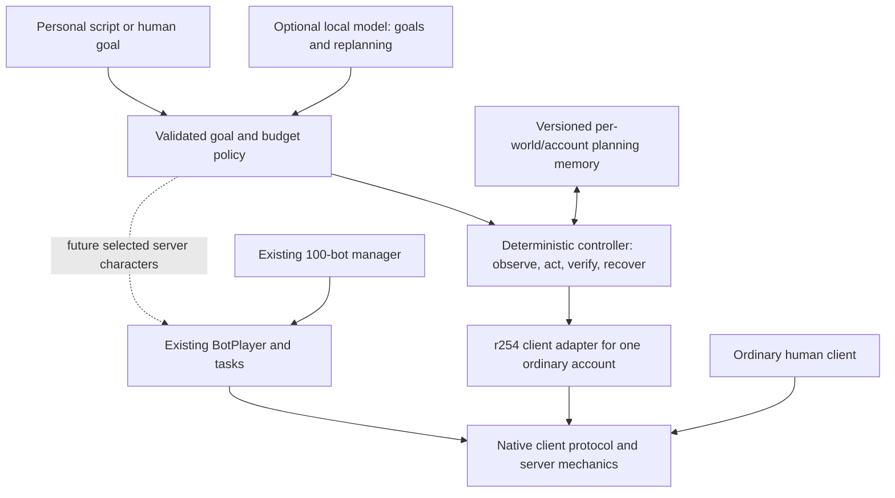

# External bot frameworks on Progressive r254

Investigation date: 2026-11-20. Baseline: merged PR #6, `90ed029b03e1f6d0d1fbbb6526d892b229f22742` on `dev`. This PR retains r254 and all existing production behavior. Experimental files have no imports from the normal client entry, bundle script, engine startup or population manager. The isolation follow-up adds optional listener arguments to two native server APIs while retaining their production defaults, plus a file-only guard for static HTTP serving. No external framework, model service or production dependency is installed by this change.

## Recommendation and evidence boundaries

Keep r254. Build a narrow adapter around the existing r254 client for an ordinary personal account, and independently implement useful planning patterns around existing server bot tasks. RS-SDK's historical r254 source makes this substantially more credible than attempting to reverse-port either current r289 client. Neither current upstream is a drop-in dependency for this server.

“Source verified” below means inspected implementation and history at pinned commits. It does **not** mean an upstream client was run successfully against Progressive. The browser proof of concept uses an independently written adapter around **our** client; it does not install RS-SDK or claim rs2b0t ABI compatibility. Proposed AI integration and whole-framework ports remain design assessments.

The supplied `https://github.com/rs-sdk` returned 404. The identifiable RuneScape automation project is [MaxBittker/rs-sdk](https://github.com/MaxBittker/rs-sdk); this report evaluates that repository, rather than silently treating the supplied address as a working organization. [2004Bot's API page](https://2004bot.com/docs/api/) links to rs2b0t and documents its `@rs2b0t/api` ABI. They are one implementation, not two independent compatibility options. The served documentation identifies a September build, so the pinned repository is authoritative when they differ.

## Framework compatibility matrix

| Framework / snapshot | Revision evidence in source | r254 history | Direct compatibility with this server | Practical reuse |
| --- | --- | --- | --- | --- |
| RS-SDK current, `3506b20cc767c6284375fb30390cb47b098d2c12` | `server/webclient/src/client/Client.ts` declares 289 and writes a **two-byte** version at login; matching engine/client/content fork | Yes: upgrade to 254 at `392487b6e0fdcb8b0265722197be7b717fe2a3ba`, 2026-03-14; pre-274 snapshot below | No. A gateway relays state/actions to a specially instrumented client; it is not a game-protocol translator | State/action/result contracts, bounded action helpers, local gateway/MCP architecture; port client-facing adapter |
| RS-SDK r254 reference, `d37ae26080b7257a7ec766eb4b3bd00ed8be6a4c` (parent of upgrade to 274) | `CLIENT_VERSION = 254`; login uses `p1(CLIENT_VERSION)`; client methods for walking, entities, dialogue, bank and inventory | Concrete implementation, not a documentation inference | Promising reference, **not runtime certified here**. Still assumes its own client extensions, UI IDs, content and SDK gateway messages | Use as a porting reference; prefer a small adapter to our current client so Progressive fixes remain intact |
| 2004Bot website | API documentation for rs2b0t, including the global client ABI and scripts | No separate historical implementation identified | Not an independently connectable SDK/service | Same opportunities and restrictions as rs2b0t |
| rs2b0t current, `27e57fa331656df5a0d9b7b1cd1f4ec0c44519bb` | `src/client/io/ClientProt.ts` exports 289; login writes `p2`; README specifies rs2b2t, not general Lost City support | Initial vendored client `60ba0a1` uses 274. Transition to 289: `8e7d965be2071d6ec65c3265e12af797082d720a`, 2026-09-06. No r254 client found in inspected public refs/revision history | No. The repository description still says 274, but executable source says 289. ABI shim requires a running instrumented client | Pure planners, quest snapshot/step pattern, banking policy, persistent objective memory; larger adapter/content port for scripts |

The history search covers fetched upstream branches/tags and revision-changing client history, not every deleted branch, private implementation or third-party fork. Absence of a discovered rs2b0t r254 implementation is not proof that none ever existed.

### Release history, licenses and dependencies

RS-SDK's inspected history moves from 245.2 to 254 on March 14, from 254 to 274 in [commit 127030dc](https://github.com/MaxBittker/rs-sdk/commit/127030dc62738728d3be0ce5eba6e5157edc269d) on May 22, and to 289 in [commit 8601955c](https://github.com/MaxBittker/rs-sdk/commit/8601955cfba4b73f9ae92ea341b131ec80ae2d0d) on October 9. The [GitHub releases endpoint](https://api.github.com/repos/MaxBittker/rs-sdk/releases) returned no releases, and the fetched repository had no tags. Pin commits; do not treat `main` as a stable versioned API.

rs2b0t began with a 274 vendored client in July and upgraded to 289 in September. Its [published release](https://github.com/rs2b2t/rs2b0t/releases/tag/nav-live-analysis-20260808) is a navigation analysis/log artifact release, not a certified r254 client distribution. The package `@rs2b0t/api` declares version 0.1.0 and separately checks runtime `apiVersion === 1`. That is an **API ABI version**, unrelated to game revision 254/289.

| Project | License inspected | Runtime / build dependencies and cost |
| --- | --- | --- |
| RS-SDK | [MIT, copyright Lost City](https://github.com/MaxBittker/rs-sdk/blob/3506b20cc767c6284375fb30390cb47b098d2c12/LICENSE) | Bun-oriented scripts and WebSocket gateway; browser bot client or optional lite client; vendored rsmod pathfinder/WASM and generated collision JSON; root package includes MCP SDK, `open`, prompts, Puppeteer development tooling and TypeScript. Its vendored server has a separate dependency graph. Do not import the entire server just to get automation. |
| 2004Bot / rs2b0t | [MIT, copyright N64Jive](https://github.com/rs2b2t/rs2b0t/blob/27e57fa331656df5a0d9b7b1cd1f4ec0c44519bb/LICENSE) | Browser client, `fflate`, TypeScript and Bun build tooling; optional desktop wrapper; Playwright, lint and other development tooling. The tiny external API package reads `globalThis.__rs2b0t`; it cannot operate as a standalone server-side library. Its navigation worker and generated data must also be provided. |

MIT permits reuse with the copyright/permission notice retained in copies or substantial portions. Transitive licenses and asset provenance must be checked for any actual vendoring; an MIT top-level license is not a blanket license for unrelated game assets. This PR copies no upstream implementation, map/transport data, bots, collision pack or vendored engine. It uses the existing local client and independently written experiment code. No upstream installation scripts were executed.

RS-SDK's demo changes XP, energy, random events and other content; those changes are not requirements of the state/action gateway and must not be brought into Progressive. Its current market/custom-interface assumptions are also specific to that fork. None of those gameplay changes are adopted here.

## Reusable capabilities compared with our bots

Value refers to incremental improvement over PR #6, not the size of an upstream feature list. Complexity assumes independent implementation using current server bot APIs; estimates are engineer days including focused native tests, not promises of full parity.

| Rank / capability | Existing Progressive behavior | Inspected upstream implementation / transferable part | Value / complexity / recommendation |
| --- | --- | --- | --- |
| 1. Activity selection and long-term goals | `BotGoalPlanner` uses personality weights, tool/coin requirements and skill steps; `BotPlayer` rotates activities and bounds failures | rs2b0t `AccountLeveler/planner.ts` resolves supply dependencies, detects cycles, resumes an objective and balances training priorities | High / medium, 3–5 days for a narrow planner. Add an opt-in objective plan above existing tasks; preserve all current weights/population and PK behavior |
| 2. Persistent character memory | Native saves retain XP, inventory, bank, varps and coordinates. Retry, route and current-task memories are mostly process-local | `AccountLeveler` persists objective, attempts, recent activities, cooldowns, deaths and bounded diagnostics to account-keyed browser/desktop storage | High / low–medium, 2–3 days. Separate versioned sidecar memory with TTLs; re-observe game facts after restart. Never use memory to assign XP, quest state or items |
| 3. Observable action contracts / autonomous decisions | Native tasks and PR #6 increasingly verify reachable targets, arrivals and service outcomes; diagnostics are mostly internal | RS-SDK distinguishes dispatch from game effects; rs2b0t separates readers/actions and pauses during scene/stat loading | High / low–medium, 2–4 days for observe + a few actions. Return `pending/succeeded/blocked/timed_out` with evidence; this is the most useful common interface for personal bots and optional agents |
| 4. Inventory, equipment and banking | Existing loadouts, inventory checks, reachable bank services and banking tasks | rs2b0t `bankRules`, `Banking`, bank-session validation and keep lists; RS-SDK quantity/outcome helpers | Medium–high / low–medium, 2–4 days for declarative keep/deposit policy. Map r254 components/slots and require an observed current bank view |
| 5. Quest progression | Tutorial lifecycle and travel prerequisites exist; there is no general native quest planner comparable to rs2b0t's quest engine | `QuestSnapshot → decide → QuestStep`, eligibility/provisioning and bounded recovery; `hetty.ts` is a concrete example | High new capability / high, 4–7 days for **one** simple r254 quest, many weeks for the catalog. Re-derive stage and dialogue rules from our scripts; no varp grants |
| 6. Combat and survival | PR #5 native melee kills/XP, PR #6 legal retained approaches; existing food, retreat, ranged/magic tasks | rs2b0t `Sustain`, supervisor and loadout policies; RS-SDK death/cancellation-aware routines | Medium / medium, 3–5 days for selected non-PK characters. Keep emergency actions deterministic; do not change PKers or damage/XP mechanics |
| 7. Shopping and economics | `BotNeeds`, native shop stock/interface purchases, vendor behavior and affordable tool checks | rs2b0t supply chains and purchase budgets; RS-SDK validates quantity received rather than treating dispatch as a purchase | Medium / medium, 3–5 days for stock-aware provisioning. Their GE/prices/custom economy cannot be assumed compatible with ours; leave existing vendors unchanged |
| 8. Skill training | Broad deterministic skill tasks and native progression already exist | Both offer skill-specific routines and tools; rs2b0t composes child scripts through AccountLeveler | Medium / medium–high per skill, 2–5 days for one missing routine. Reuse task orchestration ideas; match tools, level requirements, dialogue and outputs to our content |
| 9. NPC/object interaction | Native `BotAction`, legal operating faces, obstacle scripts and result polling | RS-SDK client collector/executor; rs2b0t adapter and entity query DSL | Medium for external access, low incremental server-bot value / medium adapter work. Preserve entity identity, current options and freshness; names alone collide |
| 10. Pathfinding/world traversal | PR #6 already has live collision, bounded A*, reachable alternatives, held goals, door/floor/travel prerequisites and failure cooldowns | rs2b0t worker A*, transport graph, danger exclusions and outcome-verified walker; RS-SDK local collision/door memory | Low–medium incremental / high for full port. Preserve PR #6; consider a future measured danger/cost policy. Do not replace current routing or copy a 289 transport/collision pack |

General autonomous behavior in these projects is mostly deterministic orchestration, state machines and recovery. RS-SDK offers an agent-friendly coding/tool loop; this is not evidence that every bot needs an LLM. rs2b0t's `api/ai` directory contains deterministic quest/clue logic, not a mandatory language-model runtime.

### Source anchors for the comparison

All links below are pinned; data and API names may change on upstream `main`.

- RS-SDK [r254 client and action methods](https://github.com/MaxBittker/rs-sdk/blob/d37ae26080b7257a7ec766eb4b3bd00ed8be6a4c/server/webclient/src/client/Client.ts), [historical state collector](https://github.com/MaxBittker/rs-sdk/blob/d37ae26080b7257a7ec766eb4b3bd00ed8be6a4c/server/webclient/src/bot/StateCollector.ts), [current action helpers](https://github.com/MaxBittker/rs-sdk/blob/3506b20cc767c6284375fb30390cb47b098d2c12/sdk/actions.ts), [pathfinding](https://github.com/MaxBittker/rs-sdk/blob/3506b20cc767c6284375fb30390cb47b098d2c12/sdk/pathfinding.ts), [MCP interface](https://github.com/MaxBittker/rs-sdk/blob/3506b20cc767c6284375fb30390cb47b098d2c12/mcp/README.md).
- rs2b0t [protocol version](https://github.com/rs2b2t/rs2b0t/blob/27e57fa331656df5a0d9b7b1cd1f4ec0c44519bb/src/client/io/ClientProt.ts), [client adapter](https://github.com/rs2b2t/rs2b0t/blob/27e57fa331656df5a0d9b7b1cd1f4ec0c44519bb/src/bot/adapter/ClientAdapter.ts), [external ABI shim](https://github.com/rs2b2t/rs2b0t/blob/27e57fa331656df5a0d9b7b1cd1f4ec0c44519bb/packages/rs2b0t-api/index.js), [planner](https://github.com/rs2b2t/rs2b0t/blob/27e57fa331656df5a0d9b7b1cd1f4ec0c44519bb/src/bot/scripts/AccountLeveler/planner.ts), [memory persistence](https://github.com/rs2b2t/rs2b0t/blob/27e57fa331656df5a0d9b7b1cd1f4ec0c44519bb/src/bot/scripts/AccountLeveler/AccountLeveler.ts).
- rs2b0t [quest snapshot types](https://github.com/rs2b2t/rs2b0t/blob/27e57fa331656df5a0d9b7b1cd1f4ec0c44519bb/src/bot/api/ai/quests/engine/types.ts), [Witch's Potion decisions](https://github.com/rs2b2t/rs2b0t/blob/27e57fa331656df5a0d9b7b1cd1f4ec0c44519bb/src/bot/api/ai/quests/defs/hetty.ts), [bank rules](https://github.com/rs2b2t/rs2b0t/blob/27e57fa331656df5a0d9b7b1cd1f4ec0c44519bb/src/bot/api/bank/bankRules.ts), [survival](https://github.com/rs2b2t/rs2b0t/blob/27e57fa331656df5a0d9b7b1cd1f4ec0c44519bb/src/bot/api/sustain/Sustain.ts), [worker pathfinder](https://github.com/rs2b2t/rs2b0t/blob/27e57fa331656df5a0d9b7b1cd1f4ec0c44519bb/src/bot/event/webwalk/PathFinder.ts).

## Technical blockers and port boundaries

1. **Wire protocol:** our client sends a one-byte 254 login revision; current upstreams use two-byte 289. Our `World.onClientData` checks revision, cache CRC and RSA block before account admission. Changing a version constant alone also leaves incompatible packet numbers, lengths, byte transforms and update decoding. Do not relax these checks.
2. **Keys and caches:** a client must use this server's actual RSA public parameters and matching r254 archives. The assembled test installation's `public.pem` was stale relative to `private.pem`: a real login failed with the native out-of-date response. The harness derives only public exponent/modulus from the listener's private key locally; it neither sends nor logs that key. Cache loading must finish before login. The experimental bundle retains the native origin check and is bound to the loopback test origin.
3. **Client adapter:** collectors read private revision-specific client fields, widget trees, options, scene entities and inventory encoding. RS-SDK needs its own client action extensions plus gateway; rs2b0t scripts need the complete ABI. The bare package import supplies neither.
4. **Content:** UI IDs, varp visibility, journal wording, entity IDs/names, option slots, transports, quest stages and skill recipes differ. rs2b0t's Witch's Potion code explicitly notes an item-name change at 289; even name-based scripts are not automatically portable. Generate/check bindings against r254 rather than relying on matching coordinates.
5. **World data:** baked collision and transport edges are revision/content-specific and can become stale dynamically. Generic A*, worker execution and route result types are adaptable; the map and prerequisites require regeneration and native validation. Never unmask production collision to make a route succeed.
6. **Scheduling and persistence:** frame counters are not server ticks. Require fresh observations, one controller per account, cancellation and bounded retries; never block world ticks on gateway/model inference. Game saves belong to the native server; planning memory belongs to a separate controller store. Client-observed bank state is unknown until opened/refreshed.
7. **Upstream environment:** RS-SDK's lite client appeared after the historical r254 snapshot and now follows later protocol/client implementations. It is not an already validated headless r254 option. Current upstream claims of human-equivalent packets are architectural claims; this PR's own native client test is the runtime evidence for our server.

## Personal accounts and simultaneous operation

A personal automated character should authenticate through the same native r254 client/login path as a human, with `is_bot === false`. It must not enroll through `BotManager`, use a `!bot` account, receive bot initialization grants, read server-only world state for decisions, or use a privileged command endpoint. It consumes one ordinary player slot. The default `NODE_MAX_PLAYERS` is 2047, so 100 configured bots plus two ordinary accounts are within the configured capacity; actual host/browser/network limits still need measurement.

Use distinct accounts for the human and automated character. A single account cannot be assumed to have simultaneous independent human and bot sessions: transfer control by pausing/revoking the bot controller, then logging in or taking over its client. Separate clients/accounts can operate concurrently without changing population allocation. Native standalone local-save login does not check passwords; shared-login mode uses the native account password validator. The final proof of concept exercises shared-login authentication with two registered non-staff accounts, including a rejected wrong password. Membership, tutorial/quest state, shops, damage, collision and inventory limits continue to be enforced by native scripts.

The experimental browser interface requires loopback and `personalBotExperiment=1`, permits login only for `pr7bot`/`pr7human`, and is built separately. The normal page has no experimental `__r254Personal` automation global. Playwright substitutes the experimental asset only for its own personal test page; it does not publish or overwrite the ordinary client asset.

## Isolation follow-up: network and filesystem boundary

The original “loopback-only” description applied to the browser bridge, **not** all server listeners. Review confirmed that the native login listener bound `0.0.0.0`, web listening used the Node wildcard default, `LoginServer` automatically started management HTTP, and the temporary world inherited `NODE_DEBUG=true` while sharing writable content/configuration paths. An Origin restriction alone does not restrict an HTTP listener or disable its editor routes. The earlier gameplay results remain valid; they did not verify network/filesystem isolation.

The revised optional harness runs the **entire controller, browser, world, login server and workers inside one disposable Docker container**. The checked configuration is `--network none`, no published ports, a read-only image root (with disposable `/experiment` storage and `/tmp` tmpfs), all capabilities dropped, and `no-new-privileges`. Only loopback exists in the container. Code, dependencies, assets, content and configuration are copied into an anonymous disposable Docker volume; **no original host runtime directory, database, save tree or Docker socket is mounted**. The original runtime path is verified absent inside the container. The launcher hashes original content/data (including configuration and any saves) and SQLite files before/after, then removes the container and volume, including on failure. It copies only requested result artifacts back out.

Within that boundary, login and game HTTP/WebSocket explicitly bind `127.0.0.1` on separately allocated ports. Management startup is disabled through an explicit constructor option, rather than moving an unnoticed listener to another wildcard port. The fixture records actual `server.address()` values; the controller independently checks **every process-owned TCP LISTEN socket** using `/proc/<pid>/fd` and the kernel socket tables. Exactly the expected two IPv4 loopback listeners are accepted, including after a fresh-process restart. There is no game TCP listener or bot-debug listener in this fixture.

The native APIs gain optional arguments only: `new LoginServer({host, management})` and `startWeb({host})`. Existing callers keep the original login host (`0.0.0.0`), wildcard web binding, automatic management startup and configured ports. `Environment` defaults, `app.ts`, ordinary startup and production configuration are unchanged. Production does not use Docker or import the experiment launcher. A file-only static-serving guard also makes directory requests such as `/maped` return 404 with engine debugging disabled; previously they could fall through to `public/maped` and crash the server with `EISDIR`. Normal static files remain served.

The world environment explicitly sets `NODE_DEBUG=false`, `NODE_PRODUCTION=true`, `EASY_STARTUP=false`, `BUILD_STARTUP=false`, and the debug-profile/socket flags false. The smoke run deliberately inherits `NODE_DEBUG=true` at the container controller level to verify the explicit world override. All mutable world data directories and content are private physical copies, with a newly initialized SQLite database and empty save profile. Even the packed cache needs a private copy: native `RandomAccessFile` opens cache files with `r+`. Filesystem permission checks that merely assume caches are opened read-only are insufficient.

Before character login and again after restart, the harness requests a real existing content path with HTTP PUT, requests a new content path with PUT, and probes the debug editor/content/data GET routes. All must return 404; the existing copied content must remain byte-for-byte unchanged and the new file must not exist. The normal game page/cache remain usable. Actual listener addresses, route statuses, container configuration, inherited/observed debug modes and original-tree hashes are retained in the [isolation follow-up results](playerbot-external-frameworks-isolation-results.json). A failed assertion stops the experiment rather than falling back to running on the host.

### Gameplay diagnostics do not require engine editing

| Mechanism | What it controls | Personal script development with `NODE_DEBUG=false` |
| --- | --- | --- |
| Engine `NODE_DEBUG` | Debug HTTP editor/content access and content-writing PUT route, plus engine script reload announcements. `NODE_DEBUG_PROFILE` / `NODE_DEBUG_SOCKET` are separate engine switches | Keep false in the experiment. None is a prerequisite for client-visible observations or action/result logging |
| `NODE_PRODUCTION` | Development worker/rebuild behavior and native login staff defaults; separate from `NODE_DEBUG` | Keep true and use ordinary non-staff accounts. Turning off editor routes alone is not a substitute for production-mode account/gameplay behavior |
| Managed bot `BOT_DEBUG_ENABLED`, `BOT_DEBUG_LEVEL`, history/snapshot settings | `BotDebugService` events, planner/task/navigation tracking, snapshots and managed-bot inspection UI; `BOT_LOG_LEVEL` separately controls bot log output | These concern the managed population, not browser personal accounts. They remain disabled/off in the smoke test; personal instrumentation must not require enabling another server listener |
| Browser gameplay instrumentation | Client action dispatch, decoded state, loaded interfaces, local failures and controller deadlines | Independent of engine debug settings. The existing experimental `observe()` and native action adapter continue to work; browser console/page errors and test result snapshots are collected with server editor routes disabled |

**Current scope:** the bridge exposes observation snapshots and scripted native actions; it does not yet provide a general manual-gameplay recorder, equipment/quest event stream or recording export UI. This follow-up documents that interface instead of implying that snapshots are a complete recorder. The normal client remains free of the experimental bridge.

### Upstream event observation and script-development evidence

At the same pinned commits used above:

- RS-SDK's [client packet-log implementation](https://github.com/MaxBittker/rs-sdk/blob/3506b20cc767c6284375fb30390cb47b098d2c12/server/webclient/src/client/Client.ts) has an opt-in log flag, timestamp/opcode/name/size/hex entries, a bounded retained log, and callbacks. Its [overlay](https://github.com/MaxBittker/rs-sdk/blob/3506b20cc767c6284375fb30390cb47b098d2c12/server/webclient/src/bot/OverlayUI.ts) explicitly supports performing actions manually, viewing the packet log, clearing it and copying it to the clipboard. This is browser tooling, independent of server content-edit endpoints. The send-loop log can contain a batch of outgoing bytes labeled with the last known opcode: it should not be treated as a complete, decoded semantic-action recording or proof of success.
- RS-SDK's [state collector](https://github.com/MaxBittker/rs-sdk/blob/3506b20cc767c6284375fb30390cb47b098d2c12/server/webclient/src/bot/StateCollector.ts), [client overlay](https://github.com/MaxBittker/rs-sdk/blob/3506b20cc767c6284375fb30390cb47b098d2c12/server/webclient/src/bot/BotOverlay.ts) and [SDK state subscriptions/action handling](https://github.com/MaxBittker/rs-sdk/blob/3506b20cc767c6284375fb30390cb47b098d2c12/sdk/index.ts) combine client state publication, game-tick callbacks, dialogue/interface options, action IDs, bounded action execution and timeout/error handling. Script development uses a local client plus observations and focused scripts. Dispatch acknowledgement and observed game effects remain distinct.
- rs2b0t's [event bus](https://github.com/rs2b2t/rs2b0t/blob/27e57fa331656df5a0d9b7b1cd1f4ec0c44519bb/src/bot/api/events/EventBus.ts) and [event producers](https://github.com/rs2b2t/rs2b0t/blob/27e57fa331656df5a0d9b7b1cd1f4ec0c44519bb/src/bot/runtime/producers.ts) emit ticks, chat, skill XP/level changes, inventory slot deltas and changed client varps. Producers use dirty categories, seed initial observations after login and reset on logout, avoiding invented “gains” from initial state. The inspected varp producer scans a limited client range; this is not privileged access to every server quest variable.
- rs2b0t exposes subscriptions for scripts, [script lifecycle/recovery](https://github.com/rs2b2t/rs2b0t/blob/27e57fa331656df5a0d9b7b1cd1f4ec0c44519bb/src/bot/runtime/ScriptRunner.ts), [quest step tracing](https://github.com/rs2b2t/rs2b0t/blob/27e57fa331656df5a0d9b7b1cd1f4ec0c44519bb/src/bot/api/ai/quests/engine/trace.ts) and [bounded diagnostic series](https://github.com/rs2b2t/rs2b0t/blob/27e57fa331656df5a0d9b7b1cd1f4ec0c44519bb/src/bot/runtime/diag/DiagRing.ts). These are useful design references for event-driven scripts and diagnostics, not evidence of a ready-made r254 manual recorder or automatic script synthesizer. No upstream implementation is copied here.

### Recommended browser-side recorder for personal characters

Add a separately compiled recorder to the experimental r254 client, disabled until an explicit **Start recording** action. Stop/export/clear must also be explicit. It should observe both manually initiated and controller-initiated native gameplay while leaving the normal client, server debug flags and the managed 100-bot population unchanged. Prefer semantic client hooks and decoded state deltas; raw mouse coordinates or encrypted packet replay alone cannot reliably reproduce gameplay.

| Requested recording | Proposed r254 observation point and evidence |
| --- | --- |
| Manual gameplay actions | Wrap native `doAction` and relevant movement dispatch points inside the opt-in client build, invoke the original exactly once, and preserve return values/exceptions. Tag the bridge's own calls as `script`; mouse/menu input as `manual`; use `unknown` when provenance cannot be established. Link nested movement/action calls rather than double-counting them |
| NPC interaction and dialogue | Capture current NPC type/index/location plus chosen native option, and interface/component ID, visible dialogue text and choice label **before** dispatch. Correlate with subsequently visible dialogue/interface state. NPC indices and component assumptions require a scene/build identity; re-resolve them on replay |
| Movement and coordinates | Record requested destination, scene epoch/plane, path-request result and actual client-visible position changes/arrival. Cover minimap and ground clicks as well as controller movement. A requested move is not arrival; keep client frame counters separate from observed server ticks |
| Inventory and equipment | Diff decoded slot IDs/counts and worn-item slots after relevant updates. Current cache bindings are `inventory:inv=3214`, `wornitems:wear=1688`; validate them against the r254 cache before use. Seed a baseline after login, and represent unavailable/replaced/modal views as unknown rather than an emptied inventory |
| Interface events | Record observed opens/closes, current roots, changed visible text, inventory updates, selected buttons and dialogue pauses/choices. Inspect only the client data; do not enable engine editor routes or fetch server script internals |
| Experience gains | Emit skill index/name, previous/new **client XP** and delta from decoded stat updates; initial login loads are baseline snapshots, not earned XP. Preserve units and distinguish XP from levels |
| Client-visible quest progression | Record transmitted client varp changes and observed quest-journal text/status with their source and confidence. Map only validated r254 journal/varp definitions. A passive recorder does not open tabs automatically; unseen/untransmitted state remains unknown. It cannot expose all server quest variables or award progress |
| Outcomes, errors and timeouts | Give each action an ID, before-state sequence, expected effect and deadline. Emit separate dispatch, pending, observed-success, explicit rejection, exception, disconnect and timeout events. Verify item receipt/XP/arrival/dialogue transitions; absence of an acknowledgement is not success. Concurrent state changes may provide correlation without proving causation |
| Structured export | Retain a bounded ring (for example 10,000 events or 5 MiB, with dropped-event counts), plus an initial snapshot. Export versioned JSON/JSONL through a browser Blob/download or a future account-scoped local controller, never a server content-writing endpoint. Exclude login credentials, key material and raw login packets; chat capture should be separately opt-in |

A recording header should identify schema version, game revision, client/cache build, world/profile/account, scene epoch, time origin and whether the counter is a server tick or client cycle. Each event needs monotonic sequence/time, action/parent IDs where applicable, provenance, typed payload and before/after evidence. Keep short bounded error/timeout details and include explicit gaps after disconnect or buffer overflow. Dirty-state notifications or native update boundaries avoid scanning the whole world every render frame.

For script development: record a short manual task, export it, review its observed prerequisites and effects, then write a deterministic routine using the typed adapter and outcome predicates. Treat recordings as examples and regression fixtures, not a command stream to replay blindly. Re-resolve targets and current options, use native pathfinding/collision, wait for real effects and preserve retry/deadline limits. A local model may help turn reviewed recordings into plans, but neither capture nor playback needs an LLM or cloud API. A recorder spike with one manually recorded NPC/dialogue/resource activity is a useful addition to PR #8 after the controller interface is stable.

### Isolation follow-up validation

The final current-source run passes with controller `NODE_DEBUG=true` deliberately inherited and world `NODE_DEBUG=false` asserted. Kernel socket inspection and `server.address()` both identify **login `127.0.0.1:43021` and web `127.0.0.1:44347`**, on both starts. Exactly two owned listening sockets exist; management is disabled. All five debug/content route probes return 404 on each start, including PUT against an existing content file; copied content is unchanged. A separate current-guard probe rejects writing to the image root with `EROFS`; a direct unisolated host invocation is rejected before starting the world. Original host content/data/configuration and SQLite hashes stay unchanged; the original runtime is absent in the container.

Browser observations, NPC/dialogue/door interactions, exact navigation, a native Logs receipt and **25 Woodcutting XP**, ordinary human-client mouse/keyboard movement, logout/restart restoration and **102 save CRCs** still pass. Both ordinary clients coexist with **100 managed bots for 134 ticks**; population minimum remains 100, SQLite has 102 accounts and quick-check is `ok`. Browser errors are zero. The 100 settled coexistence ticks measure mean/p95/max **33.66/81.19/170.56 ms**, with 0 cycles over 600 ms. These short unseeded observations are not a capacity or comparative performance guarantee.

All **49 existing regression results pass** (zero failures/skips), including bot/navigation, human/bot persistence and r254 integrity rejection cases. Engine typechecking retains 11 existing protocol diagnostics; there are no new engine diagnostics, and webclient typechecking passes. This follow-up does not implement the future general recorder; it verifies that existing gameplay instrumentation remains functional while engine editing is disabled. The initial PR #7 measurements below remain historical context.

## Proof of concept and validation (initial PR #7 evidence)

The optional harness is [personal-bot-smoke.mjs](../engine/tools/experiments/personal-bot-smoke.mjs), with a [read-only world observer](../engine/tools/experiments/personal-bot-world.ts) and [r254 client adapter](../webclient/experiments/personal-client.ts). It constructs a fresh SQLite database and save tree in `mkdtemp`, uses private copies of the assembled native packs/content/configuration inside the disposable container, and removes disposable data on completion. It never opens the original live SQLite database for writing or copies existing character saves into the test.

The [machine-readable results](playerbot-external-frameworks-results.json) record the measured states, source hashes, test outcomes and timing limits. **Verified runtime behavior is an independently implemented r254 client adapter**, not an unmodified RS-SDK/rs2b0t connection.

| Check | Verified result |
| --- | --- |
| Ordinary authentication | Shared native login server; wrong password rejected, correct password accepted; two registered ordinary accounts, neither a managed bot |
| Observation | Client-visible position, XP, inventory, nearby NPCs/locs, current interfaces and messages; server observer is used only for assertions/metrics |
| Native prerequisites | Accept character design; speak to RuneScape Guide; open the tutorial door; walk through its ordinary collision route; speak to Survival Expert; open inventory |
| Exact navigation | Arrived at `(3104,3098,0)` through native `tryMove`; NPC/loc clicks use native `doAction` |
| Activity reward | Chop a native tutorial tree: **one Logs (ID 2511), 25 Woodcutting XP**. Instructor supplies the Bronze axe and Tinderbox through native tutorial scripts. No skip, item insertion, stat assignment or quest-variable assignment by the controller |
| Personal persistence | Native logout, full world/login process shutdown and fresh-process login preserve exact XP array, inventory IDs/counts/slots and position `(3105,3096,0)`; native tutorial stage remains **40** |
| Human client | Normal client entry without experimental API; scripted physical mouse/keyboard login and design acceptance, minimap movement `(3094,3106,0)` → `(3095,3107,0)` |
| Simultaneous population | **100 managed bots + 2 ordinary clients**, 135 observed coexistence ticks (81 nominal seconds); managed population minimum stayed 100 |
| Save/database integrity | All **102 native save CRCs** valid after graceful shutdown; all 100 managed bots admitted after restart; 102 SQLite accounts, two ordinary accounts, `PRAGMA quick_check = ok` |
| Errors / original data | Zero browser page errors or logged world errors; original live/userdata SQLite hashes unchanged. Original character save trees were empty, so no existing live character was used as a preservation fixture |

The final run measured 188 world cycles after excluding the first five. It includes onboarding/cache/login work; the settled subset begins only after the personal activity completes, the human accepts design, and at least ten coexistence ticks have occurred. Both clients remain logged in while the 100-bot population continues native gameplay.

| Independent run / phase | Samples | Mean / p95 / maximum processing (ms) | Cycles over 600 ms |
| --- | ---: | ---: | ---: |
| Earlier short authenticated smoke, after first five cycles | 97 | 110.30 / 499.27 / 1,043.57 | 3 |
| Final extended smoke, after first five cycles | 188 | 47.63 / 123.40 / 509.39 | 0 |
| Final settled coexistence subset | 100 | 33.01 / 76.86 / 125.13 | 0 |

These unseeded runs are **not a paired throughput comparison**. The earlier overruns remain reported; the final short settled phase does not establish long-term capacity or a causal performance delta. Human login/design/movement and native account persistence functioned alongside all 100 bots. This does not measure a human participant's experience, network latency, contested-resource behavior, sustained inference load or multi-day operation. Tutorial Island verifies a real native activity with prerequisites; mainland banking, broad quests/combat and upstream framework parity remain unverified.

The existing regression command produced **49 passing Node test results**, zero failures/skips, covering bots, melee, navigation/native exits, persistence/tutorial lifecycle, save replacement and r254 integrity (including deliberate NPC/item/interface checksum rejection). The verified content build passed. Engine TypeScript retains the same **11 existing client-protocol errors** documented by PR #6, with zero new errors; the webclient typecheck passes. Missing-model build warnings for 434 and 2925 are pre-existing. The initial experiment changed no production file. The isolation follow-up changes optional listener arguments in native web/login APIs and rejects static directory requests; production networking/configuration defaults, population configuration, PKer behavior, progression rules and persistence schemas remain unchanged.

### Reproduce

Use an assembled **PR #6 + this branch** Progressive r254 runtime with its existing dependencies and a verified content build. Do not run the launcher over a live active world merely to prepare tests: assemble a separate runtime or copy an assembled tree excluding `.env`, SQLite files, players and logs, then apply this branch's bundle. The test runner itself creates another fresh isolated database/save profile.

```sh
# From the isolated assembled engine; normal build/integrity guards remain enabled.
BUILD_VERIFY=true BUILD_VERIFY_FOLDER=true BUILD_VERIFY_PACK=true npm run build
node --import tsx --test tests/player-save.test.ts tests/bot-reliability.test.ts \
  tests/bot-runtime.test.ts tests/bot-melee.test.ts \
  tests/persistence-runtime.test.ts tests/build-integrity.test.ts

# Optional test tooling only, outside the repository/production dependencies.
# Requires a local Linux Docker daemon at /var/run/docker.sock; no ports are published.
npm install --prefix /absolute/scratch/pr7-tools --cache /absolute/scratch/npm-cache \
  --no-package-lock --ignore-scripts playwright-core
PLAYWRIGHT_MODULE=/absolute/scratch/pr7-tools/node_modules/playwright-core/index.mjs \
PERSONAL_BOT_RESULTS=/absolute/scratch/pr7-results.json \
node tools/experiments/personal-bot-smoke.mjs
```

The launcher requires local Docker, optional Playwright tooling, esbuild (already present through the assembled development tooling), the matching local RSA key and r254 pack. It builds/caches the optional Node 24 + Chromium image from `Dockerfile.personal-bot` on first use; `PERSONAL_BOT_IMAGE` may select an existing suitable image. Chromium runs inside the container. Docker is not a production dependency. Results must be outside the source runtime. There is no unisolated-host fallback. It writes observations to the requested JSON and a separate world log, including failures. The test uses native 600 ms ticks and 1× XP; no LLM, cloud service, gameplay cheat, collision mutation or direct item/XP award is part of its controller.

## Recommended optional local-agent architecture



Start with an ordinary deterministic personal controller. Provide bounded tools such as `observe`, `walk_local`, `interact_visible`, `inventory_action`, `bank_plan`, `run_activity`, `cancel` and `logout`. Each request carries schema version, account/world, observation sequence, deadline and action ID. Results distinguish dispatched, pending, verified success, blocked and timeout, with before/after evidence. Do not promise exactly-once effects: after reconnect, reconcile inventory/position before retrying a purchase or other non-idempotent action.

The local model chooses goals such as “gather ten logs, then bank” or selects among deterministic plans. It does not control each movement tile, combat tick, dialogue continuation or food check. Run inference only for selected opt-in characters at goal completion, repeated failure, relevant state change or a coarse interval (initially 30–60 seconds). Bound concurrent inference, queue length, time and tool use. Keep the 100-bot default on its current deterministic planner. Late, malformed or unavailable model responses fall back to deterministic behavior or pause only that personal controller.

A local HTTP model runtime or a local stdio/MCP controller is sufficient. RS-SDK's MCP concepts do not mandate Claude, an OpenAI API, or any cloud service. A production controller should expose validated gameplay tools rather than unrestricted generated-code execution. Bind the gateway to loopback by default, scope credentials to one account/controller, reject stale commands, and allow immediate manual cancellation. Treat chat/world text as game data, not instructions that can redefine the goal or access the controller machine.

Persist objective, completed action receipts, bounded failure history, preferences and expiring supplier/route observations under `(world, profile, account, schemaVersion)`. Never persist invented inventory, quest stages or levels as authoritative facts. On reconnect, read native state, reconcile a pending action and resume only a still-valid goal. A new planning sidecar must not rewrite the existing game save schema or character progression.

## Effort and revision decision

These estimates assume one engineer familiar with this code and working r254 assets; they include focused validation, but not broad upstream parity or a long soak.

| Outcome | Estimated effort | Main remaining work |
| --- | --- | --- |
| Small supported external personal bot | 5–10 engineer days beyond this spike | Complete typed adapter, local controller transport, cancellation/manual handover, fresh-state handling, one banked skill loop, restart tests and packaging |
| Optional local model for one advanced personal character | Another 3–5 days | Goal/tool schemas, event triggers, bounded local inference, model-failure fallback and persistent planning memory |
| Broader personal skill/quest library | 2–4 weeks initially, then per content module | Native r254 bindings and end-to-end activity/quest tests; no blanket compatibility promise |
| Historical RS-SDK bridge adaptation | Roughly 1–2 weeks for a useful subset | Reconcile historical client APIs with Progressive, match gateway messages, map inventories/interfaces, retain notices; current helpers need selective backporting |
| Full current rs2b0t runtime/content port | Roughly 4–8+ weeks | Adapter, ABI, protocol/client retention, regenerated world catalogs and many quest/transport behaviors; maintenance continues |
| Server/client/content upgrade to 289 retaining Progressive changes | At least 6–12+ weeks, high uncertainty | Rebase custom engine/client/content, protocol/cache/UI/packs, save/progression audit and revalidation of PRs #1–6 and the entire population |

Upgrading to 289 would reduce the client-protocol mismatch with current upstreams and bring later content. It would **not** remove fork-specific interfaces, economy, adapter, deployment, data or behavioral incompatibilities. The upstream RS-SDK upgrade itself changes thousands of vendored files. Our most valuable gains—goal persistence, dependency planning, observed action results and a local-agent interface—do not require 289. There is insufficient evidence that an upgrade pays for its migration/regression risk; it also contradicts this PR's explicit r254 constraint. Keep it a separate future product decision, not a prerequisite for personal automation.

## Recommended PR #8

Implement one supported, disabled-by-default **r254 personal controller**: a versioned typed observation/action interface, a loopback controller with one account lease and manual pause, and one deterministic gather/bank activity that resumes after logout. Add a small versioned objective/failure sidecar. Validate a normal human client plus that ordinary automated account plus the unchanged 100 configured bots; include paced latency and collision/resource contention checks. Reuse existing server tasks only through a clearly separated future adapter.

Keep general quest catalog ports, population/personality changes, PKer changes, new economy systems, revision upgrades and fleet-wide LLM control out of that scope. After a reliable personal controller exists, add one optional locally hosted planner behind the same tools. Persistent objective/dependency planning for selected server-managed non-PK characters can then be reviewed independently without replacing the population system.
